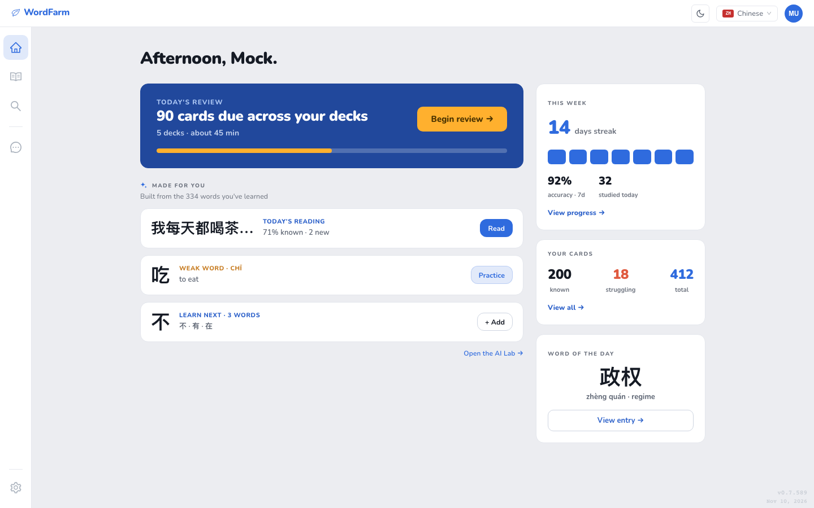
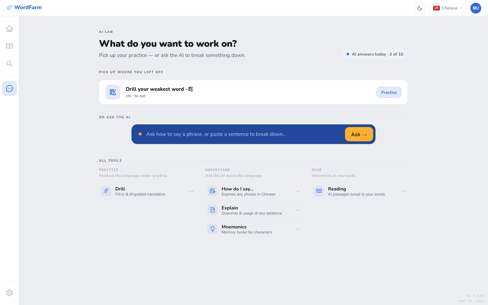
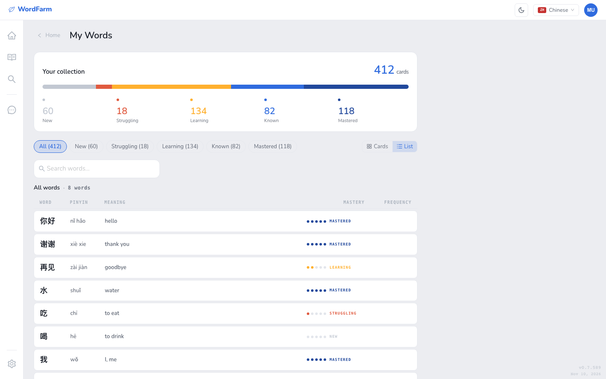
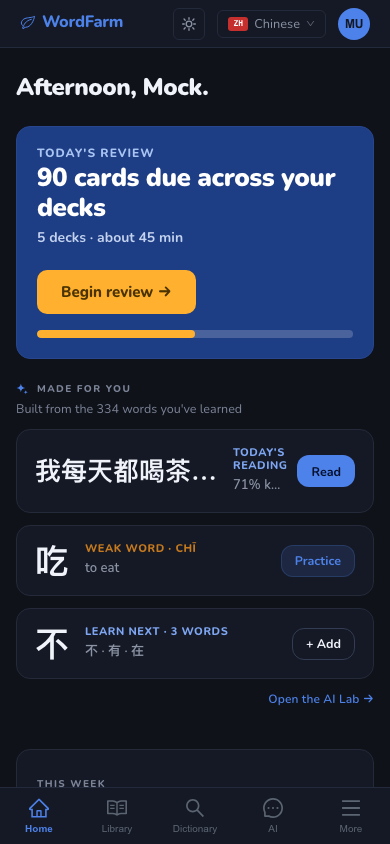
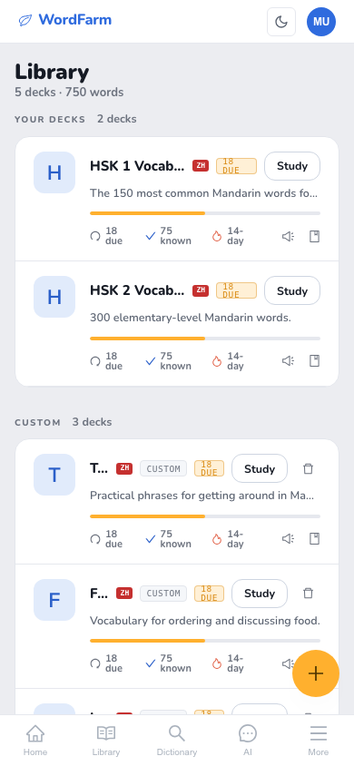
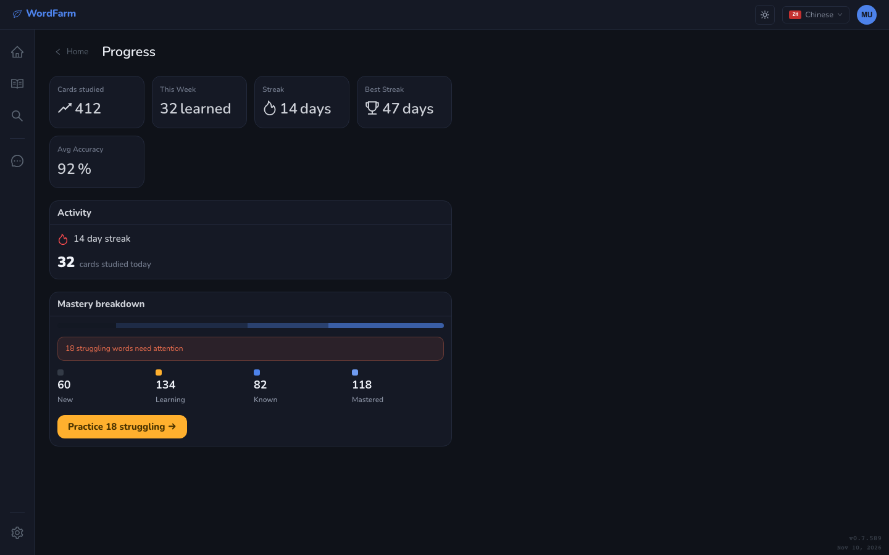
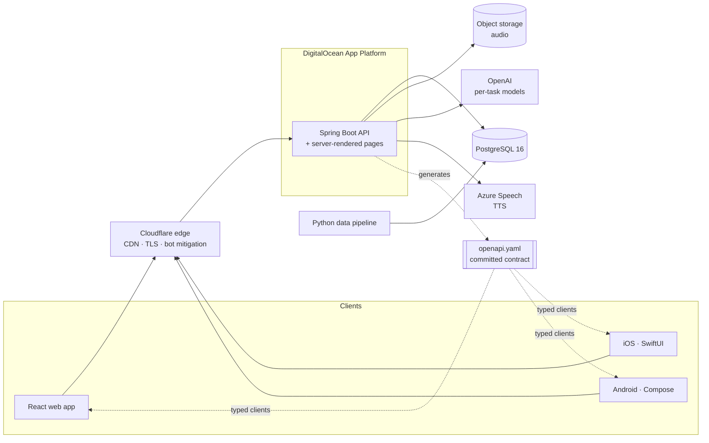

# WordFarm

**A language-learning platform for Chinese, Japanese and Korean: spaced-repetition flashcards, AI-generated reading and practice, and a six-language dictionary.**

**Live at [wordfarm.app](https://wordfarm.app)**

> This repository is a showcase. WordFarm is a live product and its source is private. I'm happy to walk through the code, or grant read access to a hiring team, on request.

I built WordFarm solo: product, design, a Spring Boot backend, a React web app, a Python data pipeline, CI/CD, production hosting, and native iOS and Android clients in progress. That's 589 commits since March 2026.

---

## What it does

**Study**
- Ready-made decks for **HSK 1–6** (Chinese), **JLPT N5–N1** (Japanese) and **TOPIK** (Korean), plus your own decks
- **Recognition** mode (reveal and self-rate) or **typing** mode, graded on the server: Damerau–Levenshtein distance for terms and token-set similarity for meanings, adjusted for hints and answer speed
- Sessions never run dry: due cards first, then new cards, then early reviews, then your weakest cards
- A hands-free **listening** mode that plays a deck as audio without touching your review schedule

**AI Lab**
- **Drill:** fill-in-the-blank and AI-graded translation for your weakest words
- **Reading:** short passages generated at your level, built around words you're due to review. Tap an unknown word to add it to your deck, then answer a quick check at the end that feeds back into scheduling.
- **How do I say…**, **Explain** (grammar and usage of any sentence) and **Mnemonics** (memory hooks for characters)

**Dictionary**
- Search across **CC-CEDICT** (Chinese), **JMdict** (Japanese), **KRDICT** (Korean) and **Wiktionary** (French, Spanish, English)
- Server-rendered public dictionary pages, so every entry can be found by search engines
- Natural text-to-speech audio for cards, words and sentences

**Build your own decks**
- Start blank, import CSV/TSV, paste a word list, or **generate a deck with AI** on any topic. Generation skips words you already know.
- An inline card editor that auto-fills from the dictionary
- **My Words** and **Progress** views: mastery breakdown, streaks, accuracy

<table>
  <tr>
    <td width="50%"></td>
    <td width="50%"></td>
  </tr>
  <tr>
    <td align="center">AI Lab</td>
    <td align="center">My Words</td>
  </tr>
</table>

  
  &nbsp;&nbsp;
  
  &nbsp;&nbsp;
  

Fully responsive, with light and dark themes

---

## Engineering highlights

### Finding and fixing a scheduler that could only go down
Every card carries an "ease" estimate: the higher it is, the longer until the card comes back. It starts at 2.50. Under the original SM-2 grade mapping, the four answer buttons moved it like this:

| Button | Before | After |
|---|---|---|
| No idea | −0.54 | −0.54 |
| Not quite | −0.32 | −0.32 |
| **Got it** (the most-pressed) | **±0.00** | **+0.06** |
| Knew it | +0.10 | +0.10 |

The neutral point sat under the button people press most, so for anyone recalling less than 100% of the time, ease could only fall. Every "mastered" check required ease above 2.5, the value a card starts with, which made mastery unreachable. On the development data, **0 of 109 cards** were Known or Mastered.

The fix treats each pair of adjacent steps as a **target recall rate**: ease stops moving when `p · up = (1 − p) · down`. The "Knew it"/"No idea" pair already settled at 0.54 / 0.64 = **84.4%**, a standard spaced-repetition target. I gave "Got it" the one increment (+0.06) that brings the "Not quite" pair to the same target (0.32 / 0.38 ≈ 84%), so the whole scale aims at one recall rate. I also added bounds an estimate needs once it can rise: ease is clamped to [1.30, 2.70] and intervals are capped at 365 days. The deltas live in config, and the code documents that changing a step without stating the recall rate it implies is a defect.

### Offline-safe answers on mobile, deliberately sent at most once
In the iOS and Android study players, a rating is written to SQLite (GRDB on iOS, Room on Android) **before** the next card appears, and the network never blocks the next card. Rows are keyed by `(session, card)`, so a double tap stores one answer, not two. The queue drains in the background and survives the app being killed.

The interesting decision is **at-most-once delivery**. The server has no idempotency key yet, and resending an answer would apply SM-2 twice and corrupt the card's interval. Dropping an answer only leaves the card due, which the next session fixes on its own. So the client retries only errors that prove the request never left the device (no connection, host unreachable, DNS failure). Timeouts and dropped connections count as unknown and are discarded on purpose. The prefetch depth (five cards ahead, refilled at two) is also treated as a correctness setting, not a performance one: the server marks cards shown when they're delivered, so every unanswered prefetched card is a card lost from the day.

### An API contract that protects apps already installed on phones
The web app ships with the server, but a mobile build stays on a phone for months. So:
- The **OpenAPI spec is generated from the running server and committed**. CI regenerates it and fails on any difference.
- CI compares each PR's spec with `main` and **fails on breaking changes**: removed, renamed or retyped fields. The only way past is a visible version bump.
- **TypeScript types, plus Kotlin and Swift clients,** are generated from the spec and compiled in CI. The Swift generator is stricter and caught real defects the Kotlin one missed.
- The endpoints mobile apps rely on are listed in a file, and tests enforce typed schemas, required fields and stable operation IDs for each one.

### AI that's useful without being expensive
- **Usage is metered per AI judgment, not per model call.** Actions where the AI evaluates or explains something for the learner count against a daily quota.
- **Each task gets its own model.** Metered judgments run on a stronger model, and background generation runs on a cheaper one.
- **The API enforces output structure, not the prompt.** Deck generation used to ask for `term | definition | pronunciation` lines and parse them with a regex. A `|` inside a definition shifted every later field, and the card saved wrong without any error. Generation now declares a JSON schema the API enforces, and the regex and three hand-written cleanup routines are deleted rather than kept as a fallback. A sanitiser still checks meaning, since a valid structure doesn't guarantee valid content.
- **Reading passages have a difficulty guardrail.** Each generated passage is split into words and compared with what the learner knows. If too many words are unknown, it's regenerated once before being served.

### An evaluation harness for the AI grader
The grader is not trusted on how it seems in use. A **hand-labelled set of trap cases** covers correct answers, natural paraphrases, and answers that are almost right but wrong. The harness runs each candidate model against that set and reports two things: agreement with the reference verdicts, and **inflation false positives** (wrong answers graded as correct). A model passes only with **zero** inflation false positives and agreement at or above the bar. If no model passes, the run fails and points at the prompt. This check is the precondition for letting AI-graded answers affect scheduling.

### Production reliability: an outage the platform would never have ended
While investigating high memory use on the JVM backend, I found that the platform's configured health check was a **readiness** probe, not a **liveness** probe. A JVM that ran out of heap and kept limping would stop receiving traffic, but would **never be restarted**: an outage that lasts until a human notices. I added `-XX:+ExitOnOutOfMemoryError`, which turns that into a crash the platform does restart, at a known cost of about 2 minutes (startup was measured at 110 s).

The restart alert had the same kind of bug. It fired at more than 3 restarts in 5 minutes, but at a 110 s startup a crash loop can only manage about 2, so the alert could never fire. It now triggers on any restart.

### Knowing which words a learner actually knows
Every card is linked to a dictionary entry when it's created, through all seven creation paths (editor, import, AI generation and so on), by one deterministic resolver. A word the user set by hand is never overwritten by the machine. Words with several pronunciations stay separate. Phrase and sentence cards deliberately give no credit for knowing individual words. This feeds reading highlights, duplicate detection and the "known words" count.

### Audio that's generated once and shared
Text-to-speech audio is stored under a hash of its text, language, voice and pronunciation. Users who add the same word share one file and one synthesis call. The hash is pinned to match exactly in both Java and Python by shared test vectors. Deleting a card drops only its reference, never the shared file.

### A data pipeline with built-in checks
All content is loaded by a Python pipeline: dictionaries, HSK/JLPT/TOPIK vocabulary, frequency ranks and example sentences. Each step declares the steps it depends on and an **integrity check that runs after it**. The runner orders the steps by dependency and stops on the first failed check. Database migrations change only the schema; data fixes go through the pipeline.

### Caching that never under-reports
The web app caches by how often data changes: never-changing content, slow-changing user data, fast-changing values like due counts and quota, and live study sessions (never cached). Screens like "all caught up" or "out of AI answers" only appear when the data behind them is fresh, and the server's answer always has the final say.

---

## Architecture

## Tech stack

| Area | Technology |
|---|---|
| Backend | Java 21, Spring Boot 3.4, Spring Security (Google sign-in + JWT), Spring Data JPA, Flyway, Bucket4j rate limiting, Togglz feature flags |
| Web | React 18, TypeScript, Vite, Redux Toolkit + RTK Query, Ant Design 5, MSW mock mode, Vitest, Playwright |
| Mobile (in development) | iOS: Swift, SwiftUI, swift-openapi-generator · Android: Kotlin, Jetpack Compose |
| Data | PostgreSQL 16 (JSONB), Python data pipeline, object storage |
| AI & speech | OpenAI (official Java SDK, per-task models), Azure Speech text-to-speech |
| Infrastructure | DigitalOcean App Platform, Cloudflare, Docker, GitHub Actions CI/CD, separate beta environment |
| Practice | OpenAPI-first contract with CI drift and breaking-change checks, architecture decision records, spec-driven changes |

## By the numbers

- **589** commits since March 2026, all by me
- **6** dictionary languages, **3** exam vocabulary systems (HSK, JLPT, TOPIK)
- **100+** backend test classes, **60+** frontend test files, plus data-pipeline tests
- **9** architecture decision records
- **3** languages of generated API code (TypeScript, Kotlin, Swift), checked on every build

---

© 2026 Michael Ruiz. All rights reserved. Screenshots use demo data.
