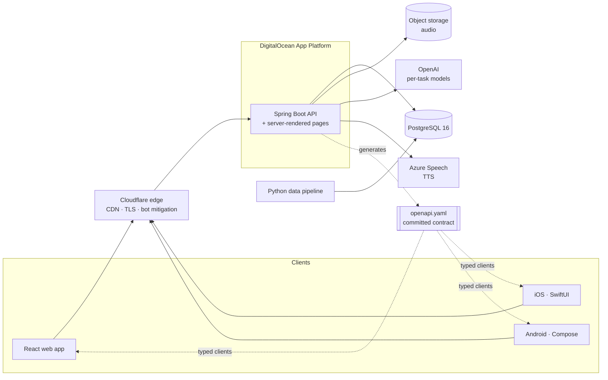

# WordFarm

**A language-learning platform for Chinese, Japanese and Korean: spaced-repetition flashcards, AI-generated reading and practice, and a six-language dictionary.**

**Live at [wordfarm.app](https://wordfarm.app)**

> This repository is a showcase. WordFarm is a live product and its source is private. I'm happy to walk through the code, or grant read access to a hiring team, on request.

I built WordFarm solo: product, design, a Spring Boot backend, a React web app, a Python data pipeline, CI/CD, production hosting, and native iOS and Android clients in progress. That's 589 commits since March 2026.

---

## What it does

**Study**
- Ready-made decks for **HSK 1–6** (Chinese), **JLPT N5–N1** (Japanese) and **TOPIK** (Korean), plus your own decks
- **Recognition** mode (reveal and self-rate) or **typing** mode, which the server grades with fuzzy matching
- Sessions never run dry: due cards first, then new cards, then early reviews, then your weakest cards
- A hands-free **listening** mode that plays a deck as audio without touching your review schedule

**AI Lab**
- **Drill:** fill-in-the-blank and AI-graded translation for your weakest words
- **Reading:** short passages generated at your level, built around words you're due to review. Tap an unknown word to add it to your deck, then answer a quick check at the end that feeds back into scheduling.
- **How do I say…**, **Explain** (grammar and usage of any sentence) and **Mnemonics** (memory hooks for characters)

**Dictionary**
- Search across **CC-CEDICT** (Chinese), **JMdict** (Japanese), **KRDICT** (Korean) and **Wiktionary** (French, Spanish, English)
- Server-rendered public dictionary pages, so every entry can be found by search engines
- Natural text-to-speech audio for cards, words and sentences

**Build your own decks**
- Start blank, import CSV/TSV, paste a word list, or **generate a deck with AI** on any topic. Generation skips words you already know.
- An inline card editor that auto-fills from the dictionary
- **My Words** and **Progress** views: mastery breakdown, streaks, accuracy

<table>
  <tr>
    <td width="50%"></td>
    <td width="50%"></td>
  </tr>
  <tr>
    <td align="center">AI Lab</td>
    <td align="center">My Words</td>
  </tr>
</table>

  
  &nbsp;&nbsp;
  
  &nbsp;&nbsp;
  

Fully responsive, with light and dark themes

---

## Engineering highlights

### A scheduler that can actually say "mastered"
Scheduling is based on SM-2, but I replaced its grade-to-ease formula. Under standard SM-2, the neutral point sat below the answer users press most often, so ease could only fall and "mastered" was unreachable. In WordFarm, each pair of adjacent grade steps encodes an explicit **target recall rate**, so changing a step means stating the recall rate it implies. All of this lives in config, and an answer with no rating is rejected rather than defaulted.

### An API contract that protects apps already installed on phones
The web app ships with the server, but a mobile build stays on a phone for months. So:
- The **OpenAPI spec is generated from the running server and committed**. CI regenerates it and fails on any difference.
- CI compares each PR's spec with `main` and **fails on breaking changes**: removed, renamed or retyped fields. The only way past is a visible version bump.
- **TypeScript types, plus Kotlin and Swift clients,** are generated from the spec and compiled in CI. The Swift generator is stricter and caught real defects the Kotlin one missed.
- The endpoints mobile apps rely on are listed in a file, and tests enforce typed schemas, required fields and stable operation IDs for each one.

### AI that's useful without being expensive
- **Usage is metered per AI judgment, not per model call.** Grading a translation or explaining a sentence counts against a daily quota. Generating practice items and grading fill-in-the-blank locally don't.
- **Each task gets its own model.** Paid-for judgments run on a stronger model, and background generation runs on a cheaper one.
- **The translation grader is checked by an evaluation harness** before it's allowed to affect scheduling.
- **Reading passages have a difficulty guardrail.** Each generated passage is split into words and compared with what the learner knows. If too many words are unknown, it's regenerated once before being served.

### Knowing which words a learner actually knows
Every card is linked to a dictionary entry when it's created, through all seven creation paths (editor, import, AI generation and so on), by one deterministic resolver. A word the user set by hand is never overwritten by the machine. Words with several pronunciations stay separate. Phrase and sentence cards deliberately give no credit for knowing individual words. This feeds reading highlights, duplicate detection and the "known words" count.

### Audio that's generated once and shared
Text-to-speech audio is stored under a hash of its text, language, voice and pronunciation. Users who add the same word share one file and one synthesis call. The hash is pinned to match exactly in both Java and Python by shared test vectors. Deleting a card drops only its reference, never the shared file.

### A data pipeline with built-in checks
All content is loaded by a Python pipeline: dictionaries, HSK/JLPT/TOPIK vocabulary, frequency ranks and example sentences. Each step declares the steps it depends on and an **integrity check that runs after it**. The runner orders the steps by dependency and stops on the first failed check. Database migrations change only the schema; data fixes go through the pipeline.

### Caching that never under-reports
The web app caches by how often data changes: never-changing content, slow-changing user data, fast-changing values like due counts and quota, and live study sessions (never cached). Screens like "all caught up" or "out of AI answers" only appear when the data behind them is fresh, and the server's answer always has the final say.

---

## Architecture

## Tech stack

| Area | Technology |
|---|---|
| Backend | Java 21, Spring Boot 3.4, Spring Security (Google sign-in + JWT), Spring Data JPA, Flyway, Bucket4j rate limiting, Togglz feature flags |
| Web | React 18, TypeScript, Vite, Redux Toolkit + RTK Query, Ant Design 5, MSW mock mode, Vitest, Playwright |
| Mobile (in development) | iOS: Swift, SwiftUI, swift-openapi-generator · Android: Kotlin, Jetpack Compose |
| Data | PostgreSQL 16 (JSONB), Python data pipeline, object storage |
| AI & speech | OpenAI (official Java SDK, per-task models), Azure Speech text-to-speech |
| Infrastructure | DigitalOcean App Platform, Cloudflare, Docker, GitHub Actions CI/CD, separate beta environment |
| Practice | OpenAPI-first contract with CI drift and breaking-change checks, architecture decision records, spec-driven changes |

## By the numbers

- **589** commits since March 2026, all by me
- **6** dictionary languages, **3** exam vocabulary systems (HSK, JLPT, TOPIK)
- **100+** backend test classes, **60+** frontend test files, plus data-pipeline tests
- **9** architecture decision records
- **3** languages of generated API code (TypeScript, Kotlin, Swift), checked on every build

---

© 2026 Michael Ruiz. All rights reserved. Screenshots use demo data.
